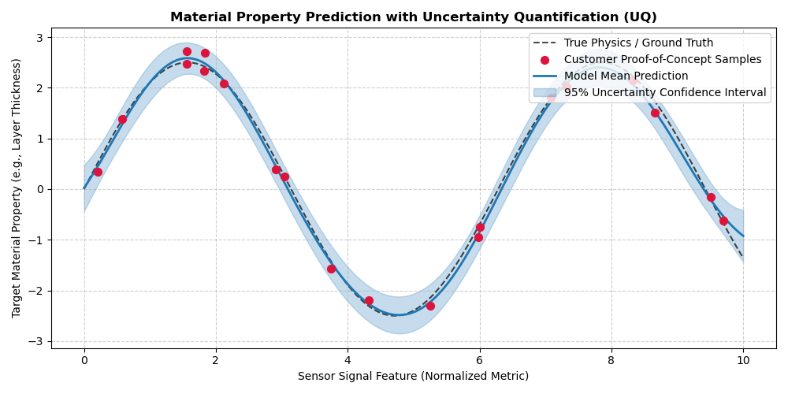

# Physics-Informed Probabilistic Regression with Uncertainty Quantification (UQ)

Fits a predictive Gaussian Process Regressor mapping sensor signal metrics to physical material properties (e.g., film thickness or density) while estimating epistemic uncertainty for customer proof-of-concept evaluations.

## Technical Capabilities
- Implements `GaussianProcessRegressor` with an RBF kernel and `WhiteKernel` to model physical smoothness alongside sensor observation noise variance.
- Computes 95% prediction confidence intervals
- Plots continuous prediction bands against ground-truth material measurements.

  
